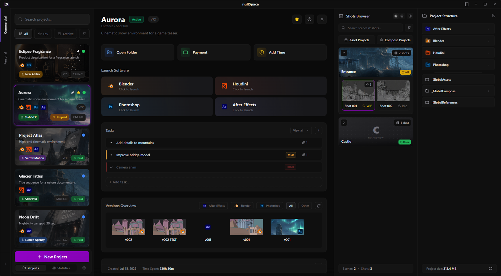
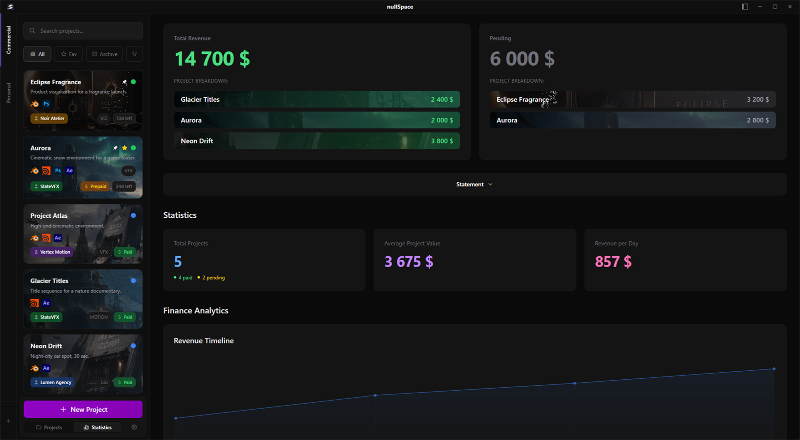
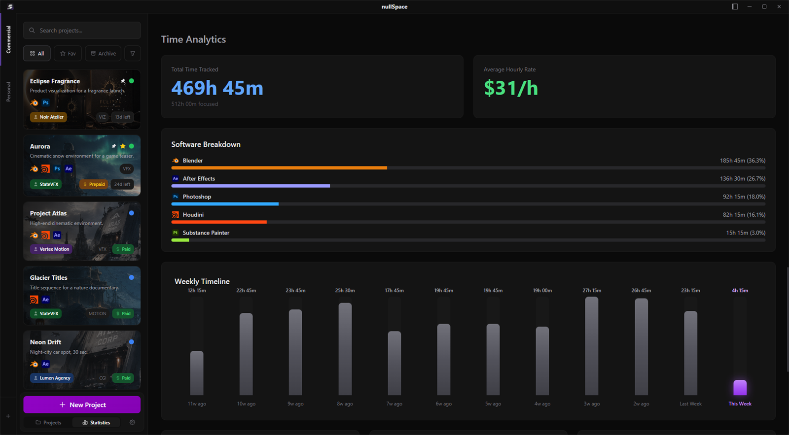

<div align="center">


# nullSpace

**Desktop project manager for artists**

Shots, versions, renders, time and money — in one place, wired into the tools you already use.


<br>

**Support development**

[](https://ko-fi.com/mendelsonvfx)
&nbsp;
[](https://boosty.to/mendelsonvfx/donate)

<sub>International via Ko-fi • Russian cards via Boosty</sub>

</div>

---

## About

nullSpace keeps a freelance or small-studio VFX project organized from first file to final payment. It builds the folder structure, names and versions your scene files, launches the right software for the right shot, tracks how long you spend in it, and turns it into clear financial reports.

<p align="center">
  
</p>
<p align="center">
  
  
</p>

## Highlights

<table>
<tr>
<td width="50%" valign="top">

### 🚀 One click from shot to scene
Pick a shot, hit **Blender**, and you're in: the right folder, the next version already created, paths set up. No *Save As*, no hunting for `v017`.

</td>
<td width="50%" valign="top">

### ⏱️ Time tracking without a timer
nullSpace notices when Blender, Houdini or After Effects is running and tells focused work apart from idle time. Nothing to start, nothing to forget.

</td>
</tr>
<tr>
<td valign="top">

### 📊 Stats that build themselves
Every tracked hour and every payment feeds the analytics on its own: revenue by month, project and client, pending payments, your real hourly rate, time per software and per week. No spreadsheets.

</td>
<td valign="top">

### 📂 Your files stay yours
No cloud, no account. Projects are plain, human-readable folders that make sense without nullSpace, and the project data lives right next to your files. Copy a project to another drive or machine and nullSpace picks it up automatically.

</td>
</tr>
</table>

### Also inside
- **Deep integrations:** Resolve scripts that save `.drp` versions, Substance Painter auto-saving under the version name, Unreal projects created on first launch.
- **Previews without opening the software:** `.blend`, `.psd` and `.c4d` thumbnails are read straight from the files.
- **Finance:** clients, multi-currency, prepayments, project reports in PDF, CSV, JSON or Markdown.
- **Renders:** image sequences grouped with frame ranges, Preview / Final filters, NullConverter in the context menu.
- **Safe shot rename:** every file and folder on disk is updated, and an interrupted rename is recovered.
- **Tasks & notes:** priorities, deadlines, attachments, Markdown notes and links.
- **One portable exe** with a built-in auto-updater.

## Supported software

Every app below gets launch-from-shot, versioned file naming and automatic time tracking. On top of that:

| Software | Extra integration |
|---|---|
| **Blender** | Relative paths set up on file creation · `.blend` thumbnails |
| **Houdini** | `.hip` / `.hiplc` / `.hipnc` picked by edition (FX / Indie / Apprentice) |
| **Cinema 4D** | Render path and frame range set up on file creation · `.c4d` thumbnails |
| **Substance Painter** | New projects auto-saved under the version name |
| **Unreal Engine** | `.uproject` created on first launch |
| **After Effects** | Starts from a clean template · Global Compose |
| **DaVinci Resolve** | Open Project / Save Version scripts, `.drp` versions · Global Compose |
| **Photoshop** | `.psd` / `.psb` thumbnails |

> All product names and trademarks are the property of their respective owners. nullSpace is an independent project and is not affiliated with, sponsored by, or endorsed by the Blender Foundation, SideFX, Maxon, Adobe, Epic Games or Blackmagic Design.

## Build from source

**Requirements:** Windows 10/11 · Node.js 20+ · Rust stable

```bash
npm ci
npm run tauri dev      # run in development
npm run tauri build    # MSI / NSIS installers in src-tauri/target/release/bundle
```

> The auto-updater checks the latest release of this repository; dev builds (`tauri dev`) never check for updates.
> Release builds are produced by [`.github/workflows/release.yml`](.github/workflows/release.yml) on every `v*.*.*` tag.

## License

Proprietary. All rights reserved.
